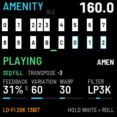

# AMENITY

A live jungle firmware for the M-VAVE FM-1, by Presethead. AMENITY plays a break (the Amen, Apache, Think,
or your own) sliced into sixteen 8ths and lets you tear it up from the panel: rolls, builds, echo and old-sampler
stretch on the white keys, single hits and instant effects on the black keys, a pattern that varies and flips itself
with a fill at the end of every phrase, ringing feedback, warp, a DJ filter, lo-fi, EQ, saturation and compression.
It follows MIDI clock from your DAW or drum machine and sends its own.

Version {{VERSION}}. Installing is at your own risk; the installer can put M-VAVE's own firmware back.

- [Install](install/): from Chrome or Edge, with the FM-1 connected by USB.
- [Your breaks](breaks/): put up to four breaks of your own on the FM-1, from the same browser.
- [Download {{PKG}}](firmware/{{PKG}}): for the command-line installer, `python3 tools/fm1_install.py {{PKG}}`.
- [Source](https://github.com/ejtb76/amenity): GPL-3.0. Built on fm1-base and felucca-bsp, from Felucca by
  Leo Kuroshita, Hügelton Instruments. The built-in breaks are third-party recordings, not covered by that licence.

M-VAVE and FM-1 are trademarks of their owners. AMENITY is not affiliated with M-VAVE.
